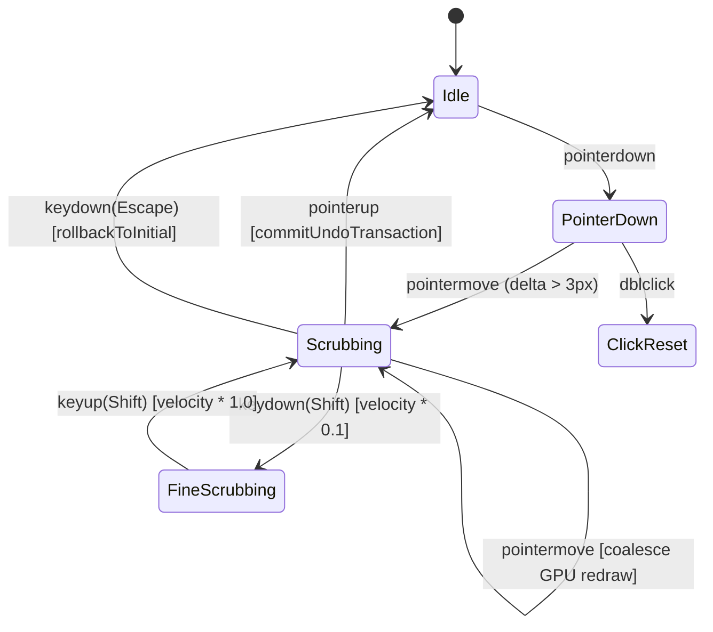

# First Proof UI & Interaction Architecture: Cross-Platform Behavioral Parity

This document defines the formal methodology for maintaining **visual, ergonomic, and behavioral parity** across native macOS desktop (AppKit/SwiftUI), web browser targets (Vite/DOM/WebGL), and future mobile field applications.

---

## 1. The Core Problem: Why Static Mockups (Figma) Fail

In high-precision photographic darkroom software, UI discrepancies between platforms are rarely just color hex codes. They stem from **behavioral and physical divergence**:
- **Pointer & Drag Lifecycles**: How pointer capture is initiated, when undo transactions coalesce, and how cancellations (Escape key) roll back state.
- **Physical Non-Linear Scaling**: Human perception of color temperature is logarithmic in Mireds ($10^6 / K$), not linear in Kelvin. Exposure operates in logarithmic base-2 powers ($2^{\text{EV}}$).
- **First-Responder Routing**: Single-key shortcuts (<kbd>1</kbd>–<kbd>5</kbd>, <kbd>P</kbd>/<kbd>X</kbd>/<kbd>U</kbd>, <kbd>C</kbd>, <kbd>Z</kbd>) must be shielded from active text fields without dropping window-level event monitors.
- **Form-Factor Ergonomics**: A 27-inch 5K studio monitor requires dense, persistent vertical sidebars with hover tooltips; a 6-inch mobile phone in the field requires single-handed bottom-docked thumb carousels and arc jog-dials.

Figma is a static 2D vector projection. It cannot compile state machines, run physical math, or enforce input event precedence. To prevent platforms from drifting, First Proof adopts the **Schema vs. Ergonomic Projection Architecture**.

---

## 2. The Schema vs. Ergonomic Projection Architecture

```
                             ┌───────────────────────────────────┐
                             │    Canonical Domain Schema & Math │
                             │      (firstproof-types::schema)   │
                             │  • Parameter ranges, steps, units │
                             │  • Physical scaling (Mired, EV)   │
                             │  • Scrub state machine contracts  │
                             └─────────────────┬─────────────────┘
                                               │
                       ┌───────────────────────┴───────────────────────┐
                       ▼                                               ▼
     ┌───────────────────────────────────┐           ┌───────────────────────────────────┐
     │        Desktop Projection         │           │         Mobile Projection         │
     │       (macOS & Web Desktop)       │           │       (iOS & Web Smartphone)      │
     ├───────────────────────────────────┤           ├───────────────────────────────────┤
     │ • Two-column layout               │           │ • Viewport canvas top 65%         │
     │ • Persistent vertical inspector   │           │ • Bottom thumb-reach sheet/drawer │
     │ • 24px precision mouse targets    │           │ • 44px touch targets + Haptic tick│
     │ • Dense tabular metadata panel    │           │ • Horizontal swipeable tool strip │
     │ • Keyboard muscle memory (<kbd>1</kbd>..<kbd>5</kbd>, <kbd>Cmd+U</kbd>) │ • Arc jog-dial / full-width scrub │
     └───────────────────────────────────┘           └───────────────────────────────────┘
```

---

## 3. Canonical Parameter Schema

Every develop adjustment is declared in a single, authoritative descriptor in `firstproof-types`:

| Parameter ID | Workspace | Range | Step | Default | Scale Mode | Format Readout |
| :--- | :--- | :--- | :--- | :--- | :--- | :--- |
| `exposure` | Light | `[-3.0, +3.0]` | `0.05` | `0.0` | `Linear` | `+0.00 EV` |
| `contrast` | Light | `[-100, +100]` | `1.0` | `0.0` | `Linear` | `0` |
| `highlights` | Light | `[-100, +100]` | `1.0` | `0.0` | `Linear` | `0` |
| `shadows` | Light | `[-100, +100]` | `1.0` | `0.0` | `Linear` | `0` |
| `whites` | Light | `[-100, +100]` | `1.0` | `0.0` | `Linear` | `0` |
| `blacks` | Light | `[-100, +100]` | `1.0` | `0.0` | `Linear` | `0` |
| `temperature`| Color | `[2000, 20000]`| `50/200`| `5500`| `Mired` | `5500 K` |
| `tint` | Color | `[-200, +200]` | `1.0` | `0.0` | `Linear` | `0` |
| `vibrance` | Color | `[-100, +100]` | `1.0` | `0.0` | `Linear` | `0` |
| `saturation` | Color | `[-100, +100]` | `1.0` | `0.0` | `Linear` | `0` |
| `deep_blue` | Color | `[-100, +100]` | `1.0` | `0.0` | `Linear` | `0` |
| `foliage` | Color | `[-100, +100]` | `1.0` | `0.0` | `Linear` | `0` |
| `sharpen_amount`| Detail | `[0, 100]` | `1.0` | `0.0` | `Linear` | `0` |
| `sharpen_radius`| Detail | `[0.5, 3.0]` | `0.1` | `1.0` | `Linear` | `1.0 px` |
| `sharpen_masking`| Detail | `[0, 100]` | `1.0` | `0.0` | `Linear` | `0` |
| `noise_reduction`| Detail | `[0, 100]` | `1.0` | `0.0` | `Linear` | `0` |
| `emulsion_exp` | Emulsion | `[-2.0, +2.0]` | `0.1` | `0.0` | `Linear` | `+0.00 EV` |
| `paper_grade` | Emulsion | `[-2.0, +2.0]` | `0.1` | `0.0` | `Linear` | `0.0` |
| `base_warmth` | Emulsion | `[-100, +100]` | `1.0` | `0.0` | `Linear` | `0` |
| `process_depth`| Emulsion | `[0, 100]` | `1.0` | `100.0` | `Linear` | `100%` |

### Non-Linear Mired Scale Formulation:
$$\text{pos}(K) = \frac{500.0 - \frac{10^6}{K}}{450.0}, \quad K(\text{pos}) = \frac{10^6}{500.0 - 450.0 \cdot \text{pos}}$$
- Below $10,000\,\text{K}$: Stepped to nearest $50\,\text{K}$.
- Above $10,000\,\text{K}$: Stepped to nearest $200\,\text{K}$.

---

## 4. Component Behavioral Contract Matrix

Any slider, jog dial, or interactive control across native Swift and Web DOM must implement the following unified state machine:



### Event Specifications:
1. **Pointer Down**:
   - Capture pointer globally (set pointer capture).
   - Record `initialValue` for rollback.
   - Do not create an undo history snapshot yet.
2. **Pointer Drag / Move**:
   - Compute parameter delta.
   - If <kbd>Shift</kbd> is held: apply $0.1\times$ precision damper (fine-tuning mode).
   - Update active preview texture (coalesced with `requestAnimationFrame` / Metal display link).
3. **Pointer Up / Release**:
   - Commit atomic undo history record with `(initialValue -> finalValue)` delta.
   - Release pointer capture.
   - Trigger asynchronous sidecar auto-save.
4. **Escape Key**:
   - Immediately revert parameter to `initialValue`.
   - Release pointer capture without pushing an undo record.
5. **Double Click / Tap**:
   - Reset parameter to canonical `default` with a 120ms ease-out spring.
   - Push discrete undo transaction (`Reset Slider`).

---

## 5. Design Token Hierarchy (W3C DTCG Format)

To eliminate visual drift, color tokens adhere to photographic darkroom invariants:

### A. Surface & Neutral Contrast Rules
- **Base Canvas Backing**: `#0c0c0e` (True OLED neutral black, avoiding blue/red casts that contaminate the photographer's eye adaptation).
- **Sidebar Background**: `#141417` (Subtle 3% luminance lift from canvas).
- **Control Well / Track**: `#1e1e24` (Recessed neutral trough with inner shadow).
- **Active Track Fill**: `#3a3a46` (Neutral gray luminance bar, zero saturated color to prevent false chroma anchoring).
- **Active Accent**: `#5599ff` (Soft photographic blue for selection rings, eyedroppers, and active tabs).

### B. Typography & Number Layout
- **Primary Font**: System UI (`-apple-system`, `BlinkMacSystemFont`, `SF Pro`, `Inter`).
- **Tabular Numerals**: All slider values, EXIF readouts, and coordinates MUST use `font-variant-numeric: tabular-nums` (monospaced digits) to prevent layout jitter during live scrubbing.
