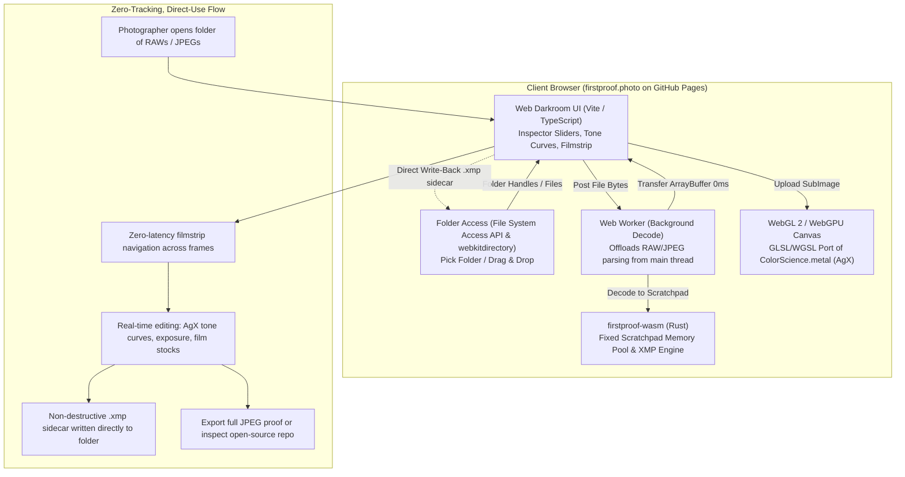

# First Proof Web Architecture: WASM Engine & WebGL Pipeline

This document defines the technical architecture for compiling First Proof's color engine and preview pipeline to WebAssembly (`wasm32-unknown-unknown`) and rendering through WebGL 2 / WebGPU.

The goal is to deliver a zero-install, 100% client-side web darkroom hosted statically on GitHub Pages (`firstproof.photo`), allowing photographers to test drive First Proof directly in the browser with zero friction.

---

## 1. System Topology & Philosophy



### Core Privacy & Anti-Slop Principles:
1. **Zero Tracking & Zero Email Capture**: No email collection forms, no "notify me" waitlists, no newsletter popups, no Google Analytics, no tracking cookies. The tool is free, private, and runs entirely in local browser RAM.
2. **Direct, Quiet Access**: When desktop builds (macOS and Linux) are ready, direct `.dmg` / AppImage / Flatpak / source links are published openly without registration gates.

---

## 2. Folder Intake & Local File System Integration

A core requirement is allowing users to **open an entire local folder** of RAW photos (e.g. from an SD card or local shoot folder) rather than just dropping single images one by one.

### 2.1 Two-Tiered Folder Access Strategy

| Strategy | Technology | Browser Support | Capabilities |
| :--- | :--- | :--- | :--- |
| **Tier 1: Read/Write Folder Sync (Preferred)** | File System Access API (`window.showDirectoryPicker()`) | Chrome 86+, Edge 86+, Opera, Safari (preview/flag) | Full folder listing, on-demand streaming read of RAWs, and **direct non-destructive `.xmp` sidecar writing** back to disk. |
| **Tier 2: Read-Only Folder Intake (Fallback)** | HTML5 Directory Input (`<input type="file" webkitdirectory directory multiple>`) | Universal (Safari, Firefox, Chrome, Edge, Mobile) | Instant recursive folder discovery and bulk file reading into memory/filmstrip. Sidecars exported via standard browser downloads. |

### 2.2 Streaming File Access & Zero Memory Bloat
When an entire folder with 500+ RAW images (20+ GB) is selected:
- **No mass preloading**: File contents are *not* loaded into browser RAM at once. Only `FileSystemFileHandle` references (or `File` metadata stubs) are stored in the in-memory filmstrip.
- **Lazy On-Demand Decoding**: As the photographer scrolls the filmstrip or selects a photo, the Web Worker reads only the selected file's slice or preview segment into the WASM scratchpad.
- **Bi-directional XMP Sidecar Sync**: When using `showDirectoryPicker()`, rating a photo (`1`–`5`, `P`/`X`) or tweaking an edit slider writes an adjacent `.xmp` file (e.g. `IMG_1024.CR2.xmp`) directly into the user's folder on disk in real time.

---

## 3. WebAssembly Core Architecture (`firstproof-wasm`)

### 3.1 Crate Separation & Scope
To avoid bloat and compilation hurdles with C libraries (`lcms2`, native SQLite), we introduce a lightweight crate: `firstproof-wasm`.

| Module | Strategy in WASM | Native Desktop Crate |
| :--- | :--- | :--- |
| **Color Science & AgX Math** | Shared directly (`firstproof-core/src/color/`) | `firstproof-core` |
| **Tone Curves (Fritsch-Carlson)** | Shared directly (`firstproof-core/src/curve.rs`) | `firstproof-core` |
| **RAW Decoding** | Fast embedded JPEG preview extraction + binned CFA | `raw_decoder.rs` |
| **XMP Sidecar Serialization** | Pure Rust `xmp-writer` + serde | `xmp/mod.rs` |
| **Database / Catalog** | Skipped in Web; in-memory folder session | `db.rs` (SQLite) |
| **Color Profiles (ICC)** | Embedded sRGB / Display P3 analytic matrices | `lcms2` fallback |

### 3.2 Memory Management: Pre-Allocated Scratchpad & Zero-Copy Transfers

In standard WebAssembly, dynamic heap allocations (`Vec::with_capacity` for 20–50MB decoded images) trigger frequent browser Garbage Collection (GC) sweeps, causing frame drops during slider tweaks.

1. **Deterministic Scratchpad Buffer**:
   - `firstproof-wasm` allocates a single, contiguous linear memory block at initialization (e.g. 64 MB) for decoding operations.
   - The RAW preview decoder decodes directly into this reserved memory offset without re-allocating heap chunks.
2. **Zero-Copy WebGL Texture Upload**:
   - The JavaScript runtime accesses the WASM memory buffer directly via `wasm.memory.buffer`:
     ```typescript
     // Direct view into WASM linear memory with zero byte-copying
     const pixelView = new Uint8Array(
       wasmInstance.memory.buffer,
       scratchpadOffset,
       width * height * 4
     );

     // Blit directly into the active WebGL texture
     gl.texSubImage2D(gl.TEXTURE_2D, 0, 0, 0, width, height, gl.RGBA, gl.UNSIGNED_BYTE, pixelView);
     ```
3. **Web Worker Threading**:
   - File parsing and Bayer preview extraction execute entirely inside a dedicated Web Worker.
   - Decoded buffers are transferred to the main UI thread via `postMessage([buffer], [buffer])` (Transferable Objects), transferring memory ownership instantaneously in 0ms.
4. **LRU Ring Buffer**:
   - A 5-slot in-memory ring buffer (matching `PreviewRingBuffer` from the Mac app) retains recent frames in browser memory so filmstrip navigation between adjacent photos has zero perceived latency.

---

## 4. WebGL 2 Shader Pipeline (Parity with Metal)

The web canvas runs a GLSL 3.00 ES fragment shader that ports the exact mathematical transforms from [`ColorScience.metal`](file:///home/remco/src/firstproof/FirstProofApp/Sources/Shaders/ColorScience.metal) and [`Shaders.metal`](file:///home/remco/src/firstproof/FirstProofApp/Sources/Shaders/Shaders.metal):

```
+-----------------------------------------------------------------------------------+
|                            WebGL 2 Fragment Shader Pipeline                        |
+-----------------------------------------------------------------------------------+
|  1. Coordinate Transform: Normalized UV -> Rotation Center -> Crop Inscription    |
|  2. White Balance: D65 Bradford CAT02 chromatic adaptation (Temp & Tint)         |
|  3. Linear Exposure: pow(2.0, exposure) in linear space                           |
|  4. Bilateral Base/Detail Tone Recovery: Highlights, Shadows, Whites, Blacks       |
|  5. Contrast & Tone Curve: Fritsch-Carlson monotonic cubic spline interpolation    |
|  6. Emulsion Transfer: AgX filmic tonemapping / photochemical response curves      |
|  7. Color Grading: Lift / Gamma / Gain & Split Toning                              |
|  8. Wide-Gamut Transform: Linear Rec.2020 -> Display P3 / sRGB color matrix       |
+-----------------------------------------------------------------------------------+
```

### Uniform Buffer Object (UBO) Struct Parity
The shader inputs are bound via a uniform buffer matching `EditSettings`:
```glsl
#version 300 es
precision highp float;

layout(std140) uniform EditUniforms {
    float u_exposure;
    float u_contrast;
    float u_temperature;
    float u_tint;
    float u_highlights;
    float u_shadows;
    float u_whites;
    float u_blacks;
    float u_vibrance;
    float u_saturation;
    vec4  u_cropRect;       // left, top, right, bottom
    float u_cropAngle;
    int   u_emulsionType;
    float u_emulsionStrength;
};
```

---

## 5. Web Application Architecture (`/web`)

The web darkroom is a lightweight, zero-dependency or minimal-dependency (Vite + TypeScript) project located at `web/`.

### Key Components
1. **Folder & File Intake**:
   - **"Open Folder..." Button**: Triggers `showDirectoryPicker()` or directory file selector.
   - **Drag-and-Drop Zone**: Accepts folders or loose RAWs (`.CR2`, `.RW2`, `.ARW`, `.DNG`, `.NEF`) and JPEGs.
   - **EXIF Extraction**: Extracts metadata via WASM (Camera model, Lens, ISO, Shutter, Aperture, Timestamp).
2. **Bottom Filmstrip / Contact Strip**:
   - Horizontal thumbnail strip allowing rapid navigation across photos in the selected folder (`Left`/`Right` arrow keys).
   - Single-key star ratings (`1`–`5`) and pick/reject flags (`P`/`X`) reflected immediately on thumbnail badges.
3. **Inspector Workspace (Light, Color, Curves, Emulsion)**:
   - Modern slider rows with double-click reset, numeric scrubbers, and muscle memory shortcuts.
   - Interactive SVG Tone Curve widget mirroring `ToneCurveView.swift`.
   - Emulsion selector featuring First Proof's signature film stocks (Kodachrome 64, Portra 400, Tri-X 400, Ilford HP5).
4. **Split-Screen & Before/After Comparison**:
   - Press-and-hold original (`\`) or interactive split slider comparing:
     - Left: Original in-camera JPEG / unprocessed capture.
     - Right: First Proof 16-bit AgX filmic render.
5. **Export & Sidecar Sync**:
   - Direct write-back of `.xmp` sidecars into the open folder, or single-click `.xmp` download.
   - High-res developed JPEG proof export directly from the WebGL canvas.

---

## 6. Deployment & CI/CD Pipeline

- **Host**: GitHub Pages via automated GitHub Actions workflow on every push to `main`.
- **Domain**: Statically served at `firstproof.photo` (or `<user>.github.io/firstproof`).
- **Assets**: WASM binary gzip/brotli compressed (< 2.5 MB total payload), loaded asynchronously while rendering the landing hero section.
- **Privacy Guarantee**: 100% on-device processing. Zero network telemetry, zero email harvesting, zero cookies.
- **Desktop Release Alignment**: While active development is hosted on Linux, native desktop packaging (macOS and Linux) is decoupled into a standalone release milestone. The website provides direct links to project repositories and releases when ready.
