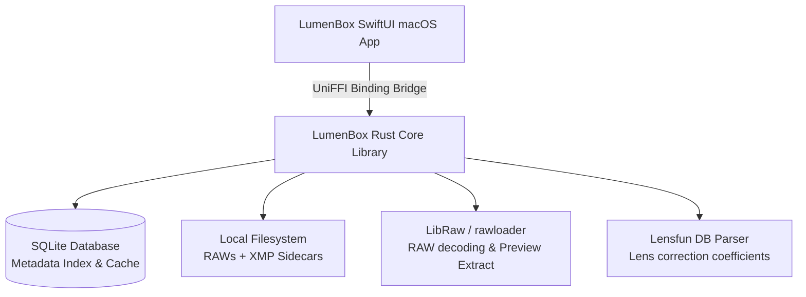

# LumenBox: RAW Photo Manager Planning

A high-performance, non-destructive photo manager desktop application for macOS. The app is optimized for speed (especially during culling and rating) and designed to process RAW images (starting with Canon CR2 and Panasonic RW2 from the Lumix LX-3), write non-destructive edits to standard XMP sidecar files, parse Google Takeout exports (restoring location metadata), and apply lens corrections using the open-source Lensfun database.

## Architecture & Technology Stack

We will use a native macOS UI linked to a shared, cross-platform core library written in Rust.



### Technical Stack
*   **UI Layer**: Swift and SwiftUI (native macOS). Leverages AppKit/SwiftUI layout engines, native menus, windowing, and file system access.
*   **Core Library**: Rust. Handles heavy-lifting tasks (file indexing, RAW parsing, SQLite database operations, XMP XML generation, Lensfun matching).
*   **Binding Bridge**: **UniFFI**. UniFFI automatically generates type-safe Swift bindings from a Rust API definition, letting Swift code call Rust methods as if they were native Swift objects.
*   **Rendering**: Decoded 16-bit RGB/float image buffers are passed from Rust into Metal textures, allowing real-time slider adjustments using GPU-accelerated shaders.

---

## Technical Specifications & Components

### 2. XMP Sidecar Interoperability Strategy
Metadata formats differ widely in standardization and visual compatibility. Here is our approach to reading and writing XMP files:

| Metadata Type | Standard / Namespace | Compatibility Approach |
| :--- | :--- | :--- |
| **Common Metadata**<br>(Ratings, Labels, Title, Description, Location) | `xmp:Rating`, `xmp:Label`, `dc:title`, `dc:description`, `exif:GPSLatitude/Longitude` | **100% Interoperable**: Read and write standard tags directly. Changes are visible in Adobe Lightroom, Finder, Apple Photos, and Darktable. |
| **Develop/Edit Sliders**<br>(Exposure, Contrast, WB, Crop) | Adobe ACR (`crs:`) vs. Custom namespace (`pm:`) | **Hybrid Overlay**: Write adjustments to our custom namespace (`pm:Exposure`, etc.). Read Adobe `crs:` tags as a read-only fallback if no `pm:` edits exist, showing a warning in the UI: *"Basic edits imported from Lightroom/ACR. Representation may vary."* |

#### Pros & Cons of This Interoperability Approach:
*   **Advantages**:
    *   Ratings, tags, and coordinates are fully shared across the entire ecosystem.
    *   Using a custom namespace (`pm:`) for edits avoids polluting files or accidentally stripping complex Adobe/Darktable tags we do not yet support.
    *   We prevent user surprise by clearly flagging imported edits that might render differently under our demosaicing pipeline.
*   **Disadvantages**:
    *   Edits made in our app will not render in Lightroom (though the rating and coordinates will).

---

## Detailed Editing Specifications & Priorities

We will structure our image editing pipeline into tiered priorities (P0, P1, P2) to build a robust foundation first, while ensuring we can expand it without changing the core architecture.

### 1. Photo Editing Features Prioritization

```
┌────────────────────────────────────────────────────────┐
│                      LUMENBOX                          │
│                                                        │
│   P0 (Foundation)        P1 (Tonal & Color)   P2 (Adv) │
│  ┌────────────────┐     ┌───────────────┐    ┌───────┐ │
│  │ - Exposure     │ ──> │ - Highlights  │ ──>│- Local│ │
│  │ - Contrast     │     │ - Shadows     │    │ Masks │ │
│  │ - Temp / Tint  │     │ - Saturation  │    │- Lens │ │
│  │ - Crop/Rotate  │     │ - Vibrance    │    │ Correct││
│  └────────────────┘     └───────────────┘    └───────┘ │
└────────────────────────────────────────────────────────┘
```

#### P0 Features (Core MVP)
These are the mathematical essentials required to make a RAW file visually usable (correcting exposure and white balance, and straightening/cropping the shot).
*   **Exposure**: Shift pixel luminance mathematically in linear RGB space.
    *   *Range*: -5.0 to +5.0 EV.
*   **Contrast**: S-curve scaling of tones around middle gray.
    *   *Range*: -100 to +100.
*   **White Balance (Temperature & Tint)**: Custom coefficients applied to the Red and Blue channels relative to Green during demosaicing.
    *   *Temp Range*: 2000K to 50000K (custom scaling).
    *   *Tint Range*: -150 to +150 (Green to Magenta).
*   **Crop & Geometry**:
    *   *Crop*: Smooth bounding box overlay allowing drag-to-crop. Pre-defined aspect ratios (Original, Freeform, 1:1, 4:3, 16:9, 3:2).
    *   *Rotate/Straighten*: Horizon alignment slider (-45° to +45°) and quick 90° rotation buttons.
*   **Reset / Compare Toggle**: Quick reset of sliders to "As Shot" and press-and-hold (e.g., `\` key) to toggle between original RAW and current edited state.

#### P1 Features (Tonal & Color Shaping - Deferred)
*   **Highlights & Shadows**: Selective compression of highlights and expansion of shadows (using high-performance tone curves or bilateral filter masks).
*   **Whites & Blacks**: Clipping adjustments for the absolute highlight and shadow ranges.
*   **Saturation & Vibrance**: Color intensity boosting (Vibrance selectively protects skin tones and avoids oversaturating already saturated colors).
*   **Vignetting Correction**: Basic radial illumination correction.

#### P2 Features (Advanced Tools - Deferred)
*   **Lens Correction**: Real-time GPU distortion (PTLens/Poly3 polynomial) and TCA (transverse chromatic aberration scaling) using the Lensfun DB lookup.
*   **Local Adjustments**: Linear gradients, radial gradients, and brushes with separate exposure/color settings.
*   **Detail (Denoise & Sharpen)**: Raw-level color and luminance noise reduction, and detail sharpening.
*   **Point-Selection Tools (Eyedroppers)**:
    *   *White Balance Picker*: Eyedropper tool to click a neutral gray/white area in the photo to automatically calculate and apply Temp/Tint multipliers.
    *   *Black/White Point Selectors*: Selection tools to click the absolute highlight/shadow areas in a photo to calibrate levels.

---

### 2. Editing Interface & Layout (SwiftUI)

We will use a sleek, dark-mode macOS native split-view design.

```
┌──────────────────────────────────────────────────────────────┐
│  [<]  LumenBox - Library      [Import]  [Cull]  [Edit]   [X] │
├────────────┬──────────────────────────────────┬──────────────┤
│ Folders    │                                  │ Adjustments  │
│ [v] Pics   │                                  │ ┌──────────┐ │
│   - Canon  │                                  │ │  Basic   │ │
│   - Lumix  │                                  │ ├──────────┤ │
│            │                                  │ │ Temp     │ │
│ [v] Drives │                                  │ │ [====|   │ │
│   - SSD    │                                  │ │ Tint     │ │
│            │                                  │ │ [==|====]│ │
│            │                                  │ │ Exposure │ │
│            │                                  │ │ [===|===]│ │
│            │                                  │ └──────────┘ │
│            │                                  │ ┌──────────┐ │
│            │                                  │ │ Geometry │ │
│            │                                  │ ├──────────┤ │
│            │                                  │ │ Aspect   │ │
│            │                                  │ │ [Original│ │
│            │                                  │ │ Angle    │ │
│            │                                  │ │ [===|===]│ │
│            │                                  │ └──────────┘ │
├────────────┴──────────────────────────────────┴──────────────┤
│ Filmstrip: [img1.cr2] [img2.cr2] [img3.rw2] [img4.cr2] [img5]│
└──────────────────────────────────────────────────────────────┘
```

*   **Left Sidebar (Library / Folder Tree)**: Easily browse folders on internal and external volumes. Collapsible to maximize edit workspace.
*   **Center Workspace (The Canvas)**:
    *   Large viewport optimized image rendering.
    *   Uses a SwiftUI-hosted `MTKView` (MetalKit View) to run our fragment shader, updating the photo in real-time at 60fps as sliders move.
    *   Interactive overlay handles for cropping/straightening.
*   **Right Sidebar (Adjustment Inspector)**:
    *   Divided into collapsible sections (Basic, Geometry, Info Panel).
    *   Sliders have readable digital fields, and **double-clicking** a slider name instantly resets it to default.
*   **Bottom Filmstrip**: Displays thumbnails of photos in the current folder. Allows quick click-to-navigate and arrow-key swapping, preserving culling rating (stars, picks) on screen.

---

### 3. Long-Term Plan & Backlog Documentation

To prevent deferred tasks (P1, P2, and roadmap items) from being forgotten, we will structure the project's documentation in a dedicated directory:
*   `docs/roadmap/`:
    *   `backlog.md`: A living document categorizing deferred features (Highlights/Shadows math, Bilateral filtering specs, Lensfun API bindings, Google Photos API authentication requirements).
    *   `architecture_notes.md`: Documentation of the core Rust-Swift bindings (UniFFI schemas) and the Metal shader data structure, ensuring that anyone extending the editing sliders in the future can simply append to the shader inputs.

---

## RAW Decoding & Snappy Culling Pipeline
To achieve "snappy" rating and culling, we must avoid full RAW bayer demosaicing when browsing. Full decoding can take 0.5 to 2 seconds per photo.
*   **Supported Formats**: Canon `.CR2`, Panasonic `.RW2` (used by Lumix LX-3), and Adobe `.DNG` (Digital Negative) files. DNG metadata and embedded previews will be extracted in the same fast path.
*   **Culling Path (Grid and Fit-to-Screen)**:
    1. Parse the RAW/DNG file (using `rawloader` or `rsraw`/`LibRaw`) to find the embedded preview image.
    2. Extract this JPEG (takes < 10ms).
    3. Cache and display this JPEG. This makes switching photos during culling feel instantaneous.
*   **Editing Path (Detailed Adjustments)**:
    1. Once the user halts on a photo to edit, decode the full bayer raw image in a background thread.
    2. Apply basic white balance (using camera coefficients or manual temp/tint) and color matrix transformation.
    3. Generate a half-resolution or viewport-fit image for real-time slider manipulation to keep GPU usage low.
    4. Send the image to the GPU (Metal texture) and apply adjustments (Exposure, Contrast, Shadows, Highlights, Crop) in a fragment shader.
*   **Edit Preview Regeneration**:
    *   Since RAW files are read-only, their embedded JPEG previews do not change when edits are made.
    *   When the user finishes editing an image, we spin up a background task to process the RAW file with the current edit settings, generate new 256px and 2048px preview JPEGs, and write them over the cached files.
    *   This ensures that the Grid and Detail views instantly reflect the user's edits (e.g., exposure changes, crops) during subsequent culling sessions.

### 4. Cache & Library Storage Management
To prevent large RAW libraries on external drives from filling up a computer's smaller internal SSD, we will implement a dual-pronged cache management strategy:

*   **Self-Contained Catalogs**:
    *   By default, the SQLite database and cache live in standard macOS directories (`~/Library/Application Support/LumenBox/`).
    *   **External Drive Detection**: When a user selects a folder to index/add, the app checks if the path begins with `/Volumes/` (excluding the macOS boot drive).
    *   **User Selection Prompt**: If an external drive is detected, the UI displays a clean toggle prompt:
        > *"LumenBox detected this folder is on an external drive. Would you like to create a portable catalog? This will save the database and preview files directly on the drive, keeping your internal SSD clean and making the library fully portable."*
    *   If enabled, database/cache resides in a hidden `.lumenbox` directory on the root of the external drive.
*   **Smart LRU Cache Limits**:
    *   **Thumbnails (256px)**: Kept permanently. At ~10KB per image, 100,000 photos require only ~1GB of disk space.
    *   **Previews (2048px)**: Capped at a user-defined limit (e.g., 5GB or 10GB). When the limit is reached, a Least Recently Used (LRU) eviction policy deletes older previews. Since previews can always be re-extracted or re-rendered from the source files on-demand, this ensures the app remains fast while keeping disk space under control.

### 5. Google Photos Takeout Importer
Google Takeout provides a `.json` sidecar file containing metadata that may have been edited or added in the cloud (e.g., descriptions, GPS coordinates, and adjusted timestamps).
*   **Match Strategy**:
    *   Scan import directories for image/video files.
    *   Look for a corresponding JSON file matching `[image_name].[ext].json` or `[image_name].json`.
    *   Account for Google Photos filename truncation (Google truncates filenames containing special characters or long names, and appends `(1)` for duplicates, creating json names like `my_photo(1).jpg.json`).
*   **Metadata Extraction**:
    *   `photoTakenTime.timestamp`: Unix timestamp (vital if EXIF timestamp is missing or wrong).
    *   `geoData.latitude`, `geoData.longitude`, `geoData.altitude`: Location data.
    *   `description`: Photo caption.
*   **Action**: If the image file lacks EXIF location data, write the extracted coordinates to the local database and the `.xmp` sidecar file, preserving location data non-destructively.

### 6. Lens Correction Database Integration
We will integrate with the open-source **Lensfun** database to correct lens distortion, transverse chromatic aberration (TCA), and vignetting.
*   **Database Lookup**:
    1. Parse the XML database from Lensfun (containing lens models and coefficients).
    2. Extract EXIF data from the image: Camera Model, Lens Model, Focal Length, Aperture, and Focus Distance.
    3. Look up the matching camera/lens configuration in the database.
*   **Correction Math**:
    *   **Distortion (Poly3 or PTLens)**: Radial coordinate transformation:
        \(r_d = r(1 + k_1 r^2 + k_2 r^4 + k_3 r^6)\)
    *   **TCA**: Scale red and blue channels independently relative to green using radial scaling coefficients.
    *   **Vignetting**: Gain adjustment based on radius:
        \(I_{corrected} = I / (1 + k_1 r^2 + k_2 r^4 + k_3 r^6)\)
*   **GPU Shader Implementation**: We will implement these mathematical transformations inside the editing fragment shader (Metal) so the correction happens in real-time without CPU bottlenecks.

---

## Future Scope (Post-v1 Roadmap)
1. **Google Photos API Sync**: Implementing direct two-way syncing. Initially, background polling to download new photos added on mobile, and later, a sharing feature to publish selected edits back to Google Photos.
2. **DNG Compression Conversion**: A tool within the app to convert raw files (CR2, RW2) into compressed Adobe DNG files, resulting in ~10% storage savings without losing image data.

---

## Verification Plan

### Automated Tests
*   **XMP Parser & Writer Tests**: Unit tests checking that creating, reading, and updating XMP sidecars preserves ratings, edits, and coordinates without dropping custom namespaces.
*   **Google Takeout Matcher Tests**: Unit tests verifying the matching algorithm against various Google Takeout naming edge cases (long filenames, duplicates, casing).
*   **RAW Metadata Extraction Tests**: Run unit tests on sample Canon CR2 and Lumix RW2 files to verify the correct extraction of ISO, focal length, lens, camera, and embedded JPEG preview.

### Manual Verification
*   **Culling Speed Benchmark**: Measure loading time when navigating through 100 RAW images using keyboard arrows. Ensure visual updates take < 50ms.
*   **Google Takeout Import Test**: Run an import session on a sample Takeout zip file. Verify that location data appears in the UI map/coordinates display and is correctly saved to the XMP sidecar.
*   **Lens Correction Shader Toggle**: Toggle lens correction on/off on a wide-angle Lumix LX-3 shot and verify that the barrel distortion disappears visually.

---

## Open Questions

> [!NOTE]
> All open structural decisions have been resolved:
> 1. **UI & Core Binding**: Using native SwiftUI frontend connected via a **UniFFI** auto-generated bridge to a shared Rust core library.
> 2. **Library & Cache Control**: Implemented a hybrid catalog layout (in-place & managed imports) utilizing portable external catalogs alongside smart LRU cache constraints.
